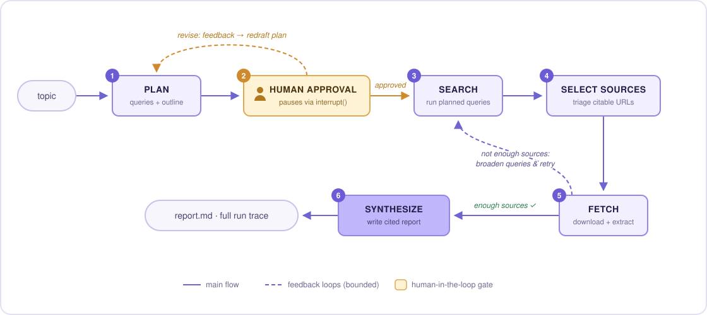
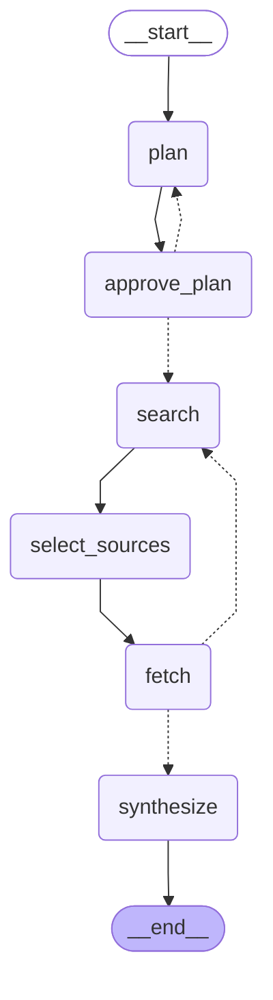

## Attribution

Aspásia was initially developed from
[Foundry AI's LangGraph Research Agent](https://github.com/foundry-ai-dev/langgraph-research-agent).

The original project provided the initial research-agent architecture
that was adapted and substantially extended for Aspásia.

# langgraph-research-agent

A multi-step **LangGraph research agent**: give it a topic, it plans its research, pauses for
**human approval**, searches the web, triages and fetches sources, and writes a **cited markdown
report** — with a full logged trace of every run.

Built as a working demo of the patterns I use in client agent projects: explicit graph control
flow, human-in-the-loop approval gates before any external actions, bounded retries, structured
outputs, and per-node unit tests.



## The graph



*(Diagram exported from the actual compiled graph: `python -m research_agent.graph`)*

| Node | What it does |
|---|---|
| `plan` | LLM drafts a structured research plan (objective, 3–5 search queries, report outline) |
| `approve_plan` | **Human-in-the-loop gate** — the graph pauses (`interrupt()`) until a person approves the plan or sends it back with feedback |
| `search` | Runs every planned query against web search; retry rounds broaden the queries |
| `select_sources` | LLM triages results — picks the most substantive, citable URLs (hallucinated URLs are dropped defensively) |
| `fetch` | Downloads pages and extracts main text; failed or thin pages are skipped, not fatal |
| `synthesize` | Writes the report with inline `[n]` citations against the fetched sources only |

The `fetch → search` dotted edge is a **bounded retry**: if fewer than `MIN_SOURCES` pages were
usable, the agent searches again with broadened queries — up to `MAX_SEARCH_ROUNDS` — instead of
writing a thin report or looping forever.

## Human-in-the-loop approval

Nothing touches the network until a person signs off on the plan. The graph checkpoints itself at
`approve_plan` via LangGraph's `interrupt()` and only resumes when the caller sends a decision:

```
=== Proposed research plan ===
Objective: ...

Search queries:
  - ...

Report outline:
  - ...

Approve plan? [y = approve / r = revise / q = quit]
```

Answering `r` sends your feedback back into the `plan` node, which redrafts and asks again. This
is the same pattern I use for client agents that gate risky actions (sending emails, writing to a
database, spending money) behind human sign-off.

## Logged traces

Every run writes a complete trace to `traces/` — every node entry, every query, every fetched URL,
token usage — so you can see exactly why the agent did what it did. A real example run is in
[`traces/trace-example.log`](traces/trace-example.log), and the report it produced is in
[`examples/`](examples/).

## Quick start

```bash
git clone https://github.com/foundry-ai-dev/langgraph-research-agent
cd langgraph-research-agent
python -m venv .venv && source .venv/bin/activate   # Windows: .venv\Scripts\activate
pip install -e ".[dev]"
cp .env.example .env                                 # add your ANTHROPIC_API_KEY

research-agent "your topic here"
```

Useful flags: `--auto` skips the approval gate (for scripted runs); `--out-dir` changes where the
report lands.

The model defaults to Claude (`claude-opus-4-8`) via `langchain-anthropic` and is configurable
with `RESEARCH_AGENT_MODEL` — the graph itself is model-agnostic.

## Tests

Every node is unit-tested in isolation with stubbed LLM and network calls — no API key needed:

```bash
pytest
```

Covered: plan revision feedback actually reaching the prompt, retry-round query broadening,
hallucinated-URL filtering in source selection, failed-fetch handling, and all three branches of
the coverage router.

## Project layout

```
src/research_agent/
├── state.py     # graph state + pydantic models (plan, sources, selection)
├── tools.py     # web search + page fetch (pure I/O, no LLM)
├── nodes.py     # one function per graph node
├── graph.py     # graph assembly; `python -m research_agent.graph` prints mermaid
├── tracing.py   # per-run trace files
├── llm.py       # single place the model is constructed
├── config.py    # env-overridable settings
└── cli.py       # terminal driver incl. the approval prompt
tests/           # node-level tests, no network, no API key
```

---

*Built by [Foundry AI](https://github.com/foundry-ai-dev) — custom AI agents & RAG systems
(LangGraph · Pinecone · FAISS). I build agents like this for clients: workflow automation,
research agents, support triage, data extraction.*
